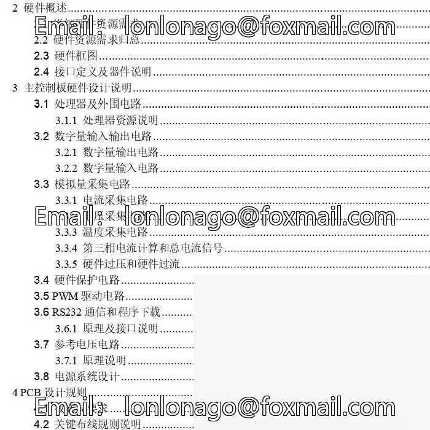
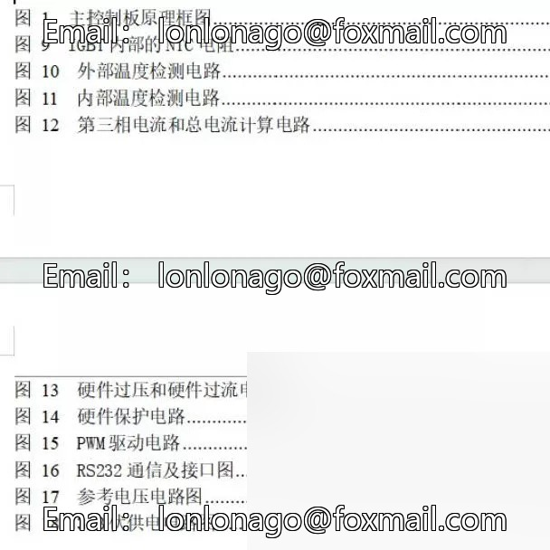
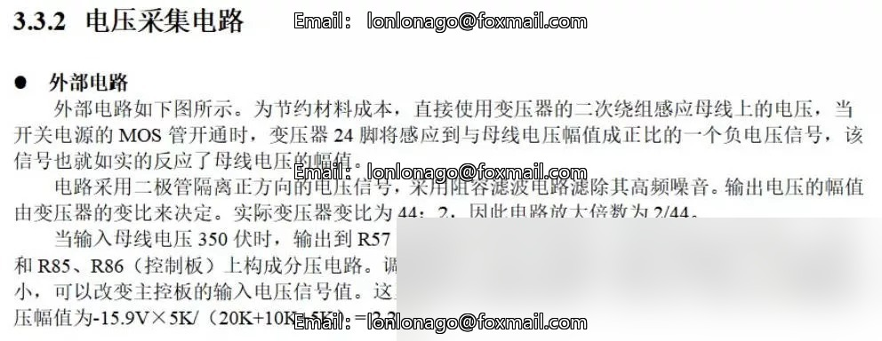

# Motor controller hardware design specification

## Body

Motor controller hardware design specification
cloud platform delivery, simply pay upon ordering.

The manual covers motor controller hardware design, including hardware resource requirements, block diagrams, interface definitions, circuit design, supply and protection schemes.

<!-- AI_ENRICHED -->

## Images

## Payment

Here is a pay link on Stripe ( https://buy.stripe.com/3cs8yP7sY87d0vu9AB ). Please contact me lonlonago@foxmail.com after funding $89, and I will send you a complete data files , thank you!

